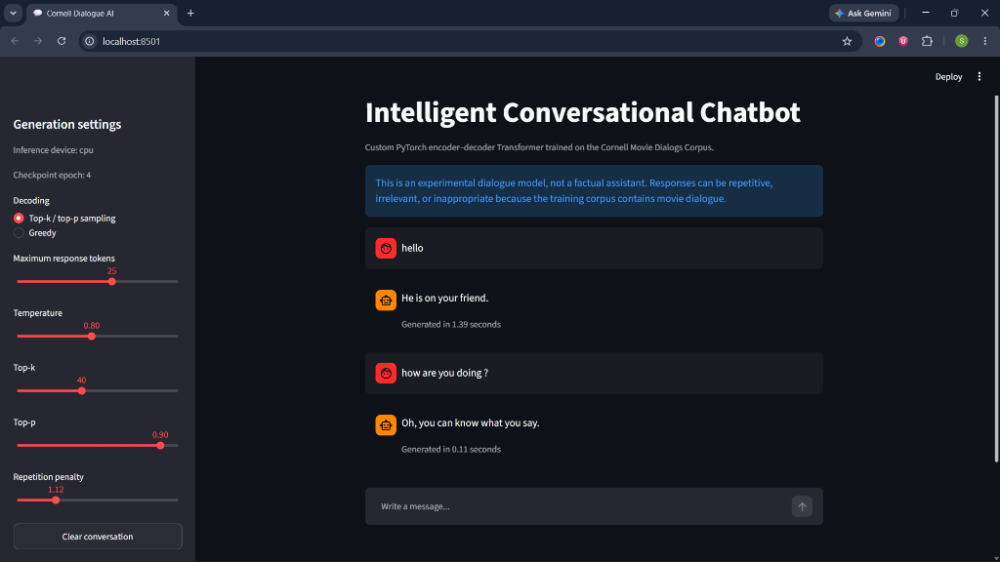
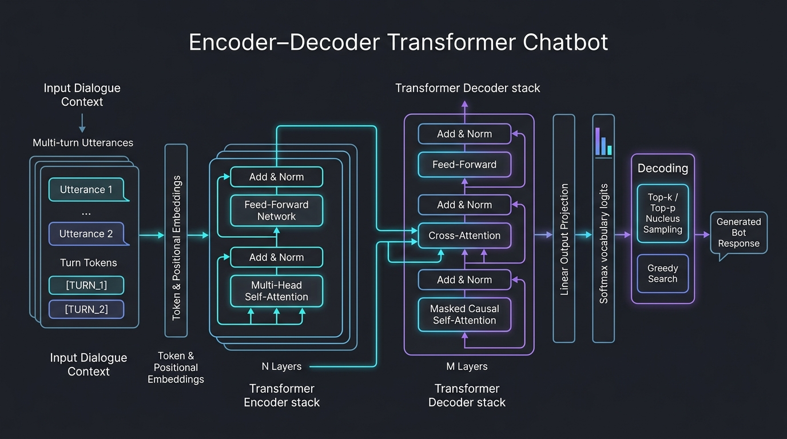

# 🤖 Intelligent Chatbot Development

A custom Transformer-based conversational AI system trained on the **Cornell Movie Dialogs Corpus** with interactive Streamlit deployment.



---

## 🔍 Project Overview

This project implements an end-to-end conversational response generation model built with an **Encoder–Decoder Transformer** in PyTorch. The model learns conversational structure and context using **multi-head self-attention mechanisms** and generates responses through **top-$k$ / top-$p$ nucleus sampling** and **repetition penalty** control.

### Key Highlights
- **Architecture**: Sequence-to-sequence Transformer (`d_model=128`, `nhead=4`, `num_layers=2/2`, feedforward `256`, ~2.6M parameters).
- **Context Handling**: Multi-turn conversational context encoding with turn boundary indicators.
- **Decoding**: Greedy decoding and Top-$k$ / Top-$p$ (nucleus) sampling with temperature and repetition penalty control.
- **Interactive UI**: Full-featured [Streamlit](https://streamlit.io/) web interface for real-time chat with latency tracking and parameter tuning.
- **Local CPU/GPU Support**: Optimized for standard laptop hardware with automatic CUDA GPU acceleration when available.

---

## 🚀 Quick Start

### 1. Install Dependencies
```bash
pip install -r requirements.txt
```

### 2. Launch the Streamlit Web Demo
Make sure the trained checkpoint exists in `artifacts/chatbot_transformer_best.pt`, then launch:
```bash
streamlit run streamlit_app.py
```
Open your browser at `http://localhost:8501` to start chatting!

### 3. Train or Experiment via Jupyter Notebook
Open and run all cells in [Intelligent_Conversational_Chatbot_Local_CPU_GPU.ipynb](Intelligent_Conversational_Chatbot_Local_CPU_GPU.ipynb):
```bash
jupyter notebook Intelligent_Conversational_Chatbot_Local_CPU_GPU.ipynb
```

---

## 📂 Project Structure

```text
Intelligent_Chatbot_Development-project/
├── assets/
│   ├── demo_screenshot.png           # Streamlit app interface preview
│   └── architecture_diagram.png      # End-to-end Transformer architecture diagram
├── artifacts/
│   ├── chatbot_transformer_best.pt   # Best checkpoint weights
│   ├── chatbot_transformer_last.pt   # Latest checkpoint weights
│   ├── tokenizer.json                # Word-level vocabulary & mapping
│   └── learning_curves.png           # Training vs. validation loss curve
├── cornell_movie_dialogs/
│   ├── movie_lines.txt               # Raw Cornell movie dialog lines (304k+ lines)
│   ├── movie_conversations.txt       # Conversation structure & turn lists (83k+ threads)
│   ├── movie_characters_metadata.txt # Character information
│   ├── movie_titles_metadata.txt     # Movie title information
│   ├── pairs_encoded.json            # Encoded dialogue pairs
│   └── WORDMAP_corpus.json           # Word mapping dictionary
├── chatbot_runtime.py                # Standalone model definition and generation engine
├── streamlit_app.py                  # Streamlit chat user interface
├── requirements.txt                  # Python dependencies
├── Intelligent_Conversational_Chatbot_Local_CPU_GPU.ipynb # Complete training pipeline
└── ChatBotzzz_backup.ipynb           # Original backup GRU-attention implementation
```

---

## 🧠 Model Architecture & Training



The chatbot employs a custom encoder–decoder Transformer tailored for multi-turn dialogue generation:
- **Input Context Processing**: Prior conversational utterances are concatenated with specialized `<turn>` separation tokens and passed through word tokenization and learned positional embeddings.
- **Transformer Encoder**: Stacks $N$ multi-head self-attention and position-wise feedforward layers with residual connections and layer normalization.
- **Transformer Decoder**: Stacks $M$ layers featuring masked causal self-attention (to preserve autoregressive generation) and cross-attention over the encoder representations.
- **Output Projection & Sampling**: A linear head projects hidden vectors to vocabulary logits, which are decoded using configurable top-$k$, top-$p$ nucleus sampling, or greedy search.

- **Objective Function**: Cross-Entropy Loss with label smoothing (`0.05`) and padding mask ignoring.
- **Optimizer**: AdamW (`lr=3e-4`, `weight_decay=1e-4`, gradient clipping `1.0`).
- **Dataset Splitting**: 80% train / 10% validation / 10% test split at the conversation level.

---

## 🎛️ Decoding Strategies

| Setting | Mode | Description |
| :--- | :--- | :--- |
| **Greedy** | Deterministic | Chooses the single highest-probability token at each step. Tends towards common phrases. |
| **Top-$k$ / Top-$p$ Sampling** | Probabilistic | Truncates the probability distribution to the most likely candidate pool ($k$) and cumulative mass ($p$), then samples. Generates varied, expressive responses. |
| **Temperature** | Scaling | Scales logits before softmax. Lower (<0.7) is focused; higher (>0.85) is creative. |
| **Repetition Penalty** | Diversity | Penalizes tokens already generated in the current response sequence. |

---

## ⚠️ Notes on Git LFS

The original Cornell raw text files (`movie_lines.txt` ~34.6 MB and `movie_conversations.txt` ~6.7 MB) are large files. If cloning from GitHub, ensure [Git LFS](https://git-lfs.github.com) is installed:

```bash
git lfs install
git clone https://github.com/Surajit00007/Intelligent_Chatbot_Development-project.git
```
